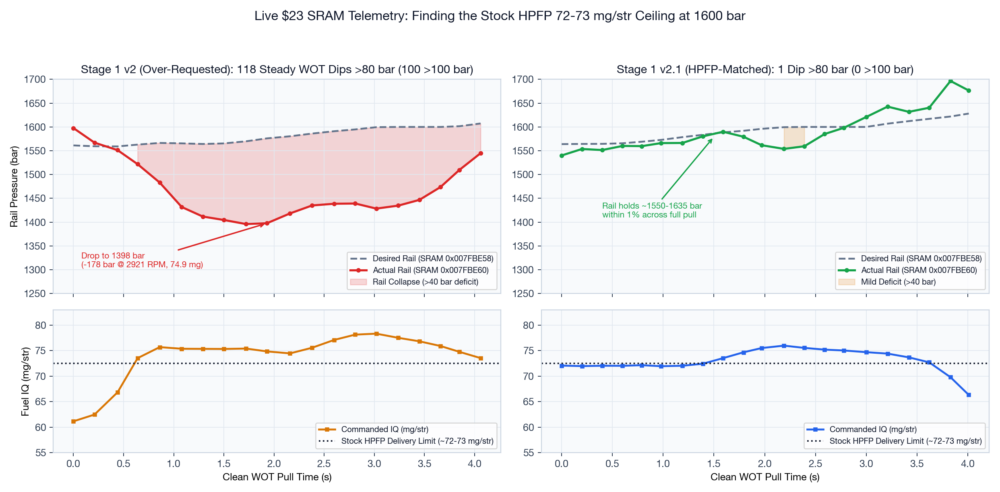

# Overclocking my car: reverse-engineering a Ford ECU from 130 to 190 HP

*By Baris Uraz · 20 November 2026 · ~5 min read · Siemens SID206 · MPC561 PowerPC*

Dumping my car's `256 KiB` ECU calibration over OBD and diffing it against stock turned up **57 silently disabled fault monitors**, including low fuel rail pressure (`P0087`), all four piezo injectors, accelerator pedals, cooling fan, and internal CPU self-test (`P0606`). On top of that, the fueling tables were skewed to under-report torque by **~10%** to the 6-speed automatic gearbox, and four engine-protection limiters had been stripped out.

The car is a 2011 Ford Mondeo Mk4.5 estate (`2.0 TDCi`, 130 PS stock, Aisin `TF-80SC` automatic, ~300,000 km). I bought it thinking the injectors were healthy and the ECU was stock aside from a previous owner's physical DPF and EGR delete. It pulled fine on the road, though bench testing later forced replacing all four injectors and a deep UDS `$19 02` scan found a `P0089` fuel-pressure fault that never lit the check-engine light. To see what was actually running on the ECU, I bought a matching `2 MiB` stock binary online, reversed its PowerPC firmware and Ford's bootloader on a Mac, restored the missing protections, and tuned it cleanly to `~190 PS (~187 HP)`.


---

## 1. Cracking the firmware and Ford's bootloader

Prying open a 15-year-old sealed aluminum ECU risks cracking the board, so I bought a matching `2 MiB` stock `.FLS` dump (`8G91-12K532-AC`) online to study the **32-bit big-endian `MPC561/MPC562` PowerPC** firmware offline. (Never flash a donor `.EPR` EEPROM; that holds vehicle-specific PATS immobilizer keys, VIN, and injector trims.) Disassembly mapped all four memory regions: `256 KiB` Bootloader, `256 KiB` Calibration at `0x040000`, `1.3 MiB` Application, and `32 KiB` internal SRAM. It also verified the `CRC-32/MPEG-2` checksums bit-for-bit and caught a live runtime checksum (`Cks2`, caller `0x562E0C`) that continuously hashes `0x040240–0x040544` while driving. Touching those bytes faults the ECU even if the header CVN checks out.

Boot flashing (`10 02`) and RAM reads (`10 03` Level `0x03`) sit behind UDS `$27 SecurityAccess`, a 24-bit Galois LFSR over `[seed(3), secret(5)]`. Public Ford scripts fail here because the ECU loads the 5-byte secret in reverse byte order. Since shifting over `GF(2)` is linear, observing even one valid CAN challenge-response pair recovers the 5-byte secret in milliseconds. Unlocking Level `0x03` opened `$23 ReadMemoryByAddress`, though its whitelist (`0x1A565C`) rejects every flash address with `NRC 0x31` and only exposes two internal SRAM windows. That killed the easy backup path, but gave me fast road telemetry later.

Instead of writing custom PowerPC shellcode to read flash and risking a brick on my daily driver, I unpacked Ford's official Secondary Bootloader named inside Boot (`6G91-14C273-DH.vbf` at `0x004290`). Disassembling that `32 KiB` RAM image was the turning point of the project: Ford's own unmodified bootloader natively implements **UDS `$35 RequestUpload`** (flash read) right alongside **`$34 RequestDownload`** (flash write). Static call-graph analysis proved `flash_erase` (`0x007FCA84`) and `flash_write` (`0x007FC920`) are unreachable from the `$35` read path. With that verified, a small Python script on my Mac over a Tactrix OpenPort 2.0 cable dumped my car's entire `256 KiB` calibration in **~35 seconds** with CRC-16 checks. (Full notes in [firmware-re.md](https://github.com/barisuraz/sid206-toolkit/blob/main/docs/sid206-firmware-re.md) and [sbl-re.md](https://github.com/barisuraz/sid206-toolkit/blob/main/docs/sbl-6g91-14c273-dh-re.md).)

```text
1. App -> Boot  : 10 02 (engine-off check @ 0x005A52D4 -> jumps to Bootloader)
2. Unlock Boot  : 27 01 -> 27 02 <key> (Boot 5-byte secret @ 0x022231, reversed bytes)
3. Load SBL     : Upload 3 official VBF SRAM segments via 34 -> 36 -> 37 (CRC-16 verified)
4. Start SBL    : 31 01 03 01 00 7F E2 54 -> confirm heartbeat 22 D1 00 -> 62 D1 00 02
5. Read ($35)   : 35 00 44 00 84 00 00 00 04 00 00 -> 1,041 × 252 B chunks (~35 s) -> 37 CRC-16
6. Write ($34)  : Offline Cks2/CVN check -> 31 01 FF 00 erase -> 34/36/37 + FF 01 CRC-16 -> 11 01 reset
```

---

## 2. Auditing 8,398 changed bytes

Diffing my car's `256 KiB` dump against stock showed it was not stock aside from DPF/EGR delete at all; someone had flashed an undisclosed remap. Using `4,784` disassembled PowerPC cross-references, `sid206 audit` classified all **8,398 changed bytes** with zero left unexplained:


**57 silently disabled fault monitors:** Fault handler `0x50A9AC` runs in two stages. Before it ever reads the 279-entry DTC table (`0x04ABC4`), it checks a debounce matrix (`0x048E84–0x049086`) for a step increment `r5`. Setting `r5 = 0` clears the fault before the DTC table is ever reached, so standard DTC editors show everything as 100% stock while the check is dead. Of `86` disabled paths, only `29` appeared in the DTC table; **57 were muted in the debounce layer**, including low rail pressure (`P0087`, which is why pressure loss only surfaced as a hidden `P0089` with no dashboard light), all four piezo injectors, pedals, cooling fan, A/C pressure (caught by a sloppy `P14xx` bulk wipe), `12` ABS/gearbox/crash CAN codes, and CPU self-test `P0606`.

**A ~10% gearbox torque lie and stripped safeties:** Instead of raising real torque limiters cleanly, whoever built the tune inflated 20 Torque-to-IQ maps (the tables converting torque to injected fuel quantity, `2,827` B total) by `+8–10%` above `200 Nm`. The engine got extra fuel while under-reporting real torque by ~10% over CAN to the Aisin automatic and throwing off warm idle. It also zeroed coolant overheat protection (`0x0790E2`), flattened oil/coolant and altitude limits to `450 Nm`, flattened limp-home to `300 Nm`, pushed intake-temp/baro boost limits `+15.1%` even at `100 °C`, and corrupted an `NTC` temperature sensor curve from `115 °C` to `205 °C`.

The car arrived with its DPF and EGR already physically removed by a previous owner, and this repo intentionally ships no emissions-delete tools or calibration builders. Before tuning for power, I flashed pure stock tables back, kept only the settings matching the hardware physically on the car (easy to revert if refitted), re-enabled all 57 safety monitors, and immediately noticed warm idle settle to a clean `5.2 RPM` std dev. ([Full breakdown](https://github.com/barisuraz/sid206-toolkit/blob/main/docs/tune-audit-case-study.md).)

---

## 3. Two bugs caught on the road

Standard OBD PID polling (~5–10 Hz) is too slow to catch quick fuel-rail pressure drops or torque-converter slip during shifts. Polling those whitelisted `$23` SRAM windows alongside synchronous `TF-80SC` gearbox telemetry exposed two problems static disassembly missed.



**Hitting the stock fuel pump ceiling:** In my first high-power test (`v2` on the chart), demanding `75–79 mg/stroke` at `1,600 bar` outran what the 300,000 km high-pressure pump could flow in the midrange. Rail pressure dropped more than `80 bar` below target `118` times, dipping as low as `-195 bar` near `2,900 RPM`. Pulling peak fuel back to `70.5–72 mg/stroke` (`v2.1`) cut `>80 bar` drops from `118` to `1` (zero over `100 bar`) and jumped measured power at `2,875 RPM` from `103.5` to `125.6 PS` (`131.5 PS` at `3,375 RPM`). Asking for less fuel literally made more power.


**The hidden automatic Drive pedal map (`0x07873E`):** On one highway test with an intermediate tune, editing all six standard Driver's Wish pedal maps (`0x051AE0–0x0524E0`) made zero difference at half throttle and the car felt flat. Back in the disassembly, caller `0x5CF024` explained why: when an automatic is in Drive, the ECU ignores all six maps and reads a separate `16×16` pedal-vs-speed table at `0x07873E` instead (which also tapers power `25–32%` above `180 km/h`). Reshaping that table with accurate 1:1 gearbox torque numbers brought back crisp highway response.

---

## 4. Results and how it drives

All acceleration and road-dyno runs below were logged in Ankara (~850 m elevation, ~923 mbar), where thinner air trims peak output slightly. Driving down to Istanbul at sea level confirmed that the factory barometric maps scale this same calibration automatically to `~190 PS (~187 HP)` and `395–400 Nm`.

| Metric | Old Remap | Restored Stock (DPF/EGR off) | Final Tune |
| :--- | :--- | :--- | :--- |
| Peak power (Ankara ~850 m / sea level) | Unlogged (flat 390 Nm limit, skewed IQ) | ~130 PS factory baseline | **180–185 PS (~190 PS / ~187 HP, 395–400 Nm)** |
| 80–120 km/h (Ankara) | Not logged | 10.3 s | **7.2–7.8 s** (60–100 km/h in 5.8 s) |
| Warm idle stability | ~3x higher jitter (noticed after stock restore) | Smooth (5.2 RPM std dev) | Smooth (5.2 RPM std dev) |
| Hidden fault codes | **57 silently muted** (injectors, fuel, CPU) | 0 (DPF/EGR only) | 0 (DPF/EGR only) |
| Gearbox torque reporting | **~10% under-reported** | Accurate 1:1 | Accurate 1:1 (rescaled cleanly) |
| High-pressure fuel rail | Hidden `P0087` (non-MIL `P0089` only) | Holds target cleanly | Holds 1,600 bar (118 dips cut to 1) |


The biggest day-to-day improvement isn't even the peak number. Now that the automatic gearbox gets accurate torque values over CAN instead of a ~10% lie, gear shifts are noticeably cleaner and smoother. The car feels crisp and responsive, warm idle is roughly 3× smoother (something I only noticed once stock data went back in), and there is far less black smoke under load, usually none. Even the dashboard fuel indicator feels a bit truer now that the ECU isn't fudging injected fuel math, though time will tell.

---

## 5. Using AI on an ECU you can't afford to brick

AI helped most with the scale problem: lifting raw `2 MiB` PowerPC disassembly into readable C, tracking `8,398` changed bytes across `4,784` references, and spotting that `0x5CF024` jumped to `0x07873E` instead of the normal pedal maps. Doing that alone would have taken weeks.

Where I drew a hard line was trusting an LLM with anything that touches flash. Every table address and branch had to check out directly in MPC561 assembly, my flasher enforces offline `CRC-32/MPEG-2` and `Cks2` checks before opening CAN, and live SRAM logs caught physical pump limits (like those `118` drops) that reading firmware alone can never tell you.

---

## 6. Code & deep-dive docs

All scanners, official-SBL backup/write tools, `$23` SRAM + `TF-80SC` loggers, road-dyno scripts, and offline tests live in [barisuraz/sid206-toolkit](https://github.com/barisuraz/sid206-toolkit) (no OEM binaries, drive logs, VINs, serials, or secrets).

- [README.md](https://github.com/barisuraz/sid206-toolkit/blob/main/README.md) — installation, arming guards, and CLI examples (`sid206 obd|re|audit|backup|flash|log-tcm|dyno`)
- [docs/sid206-firmware-re.md](https://github.com/barisuraz/sid206-toolkit/blob/main/docs/sid206-firmware-re.md) — complete `MPC561` memory map, CVNs, `$27/$23/$31` tables & DTC layout
- [docs/sbl-6g91-14c273-dh-re.md](https://github.com/barisuraz/sid206-toolkit/blob/main/docs/sbl-6g91-14c273-dh-re.md) — `6G91-14C273-DH.vbf` SBL disassembly, scheduler, dispatch table & call-graph proof
- [docs/tune-audit-case-study.md](https://github.com/barisuraz/sid206-toolkit/blob/main/docs/tune-audit-case-study.md) — full `8,398`-byte breakdown & TunerPro map offset table
