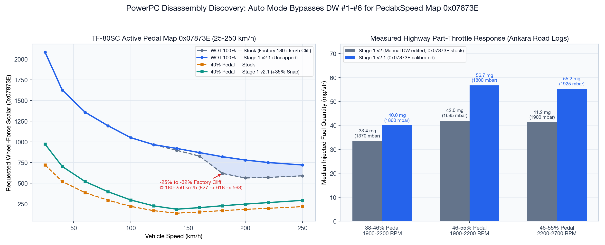

# Fixing a bad ECU tune on a 2011 Mondeo 2.0 TDCi

I bought a 2011 Ford Mondeo Mk4.5 estate (`2.0 TDCi`, 130 PS factory, 6-speed automatic) with around 300,000 km on the clock. The particulate filter (DPF) and EGR valve had already been physically removed, four fresh injectors were installed, and an unknown prior owner had flashed a remap onto it. On paper it should have pulled fine. In reality the idle was rough, highway passing felt lazy, and under hard load the fuel system threw a pressure fault (`P0089`), yet generic OBD scanners showed no check-engine light and zero stored codes.

So I pulled the full binary out of the engine computer (`SID206`) over the OBD port, bought a clean stock file to diff against, traced the prior tune's hidden patches in firmware disassembly, and built a clean `~190 PS` Stage 1 calibration verified with high-speed road logs.

---

## Results

All acceleration and road-dyno runs below were logged at around 850 m elevation in Ankara (~923 mbar ambient air pressure), where thinner air naturally costs a few percent of peak power compared to sea level. At sea level, the same tune automatically scales up to roughly `190 PS` and `395–400 Nm` through the factory barometric compensation tables.

| Metric | Old Remap | Restored Stock (DPF/EGR off) | Final Tune |
| :--- | :--- | :--- | :--- |
| Peak power (Ankara ~850 m / sea level) | Sluggish pull, pressure drops | ~130 PS factory baseline | **180–185 PS (~190 PS / ~395–400 Nm)** |
| 80–120 km/h (Ankara) | Not repeatable | 10.3 s | **7.2–7.8 s** (60–100 km/h in 5.8 s) |
| Warm idle stability | Rough (~3x worse jitter) | Smooth (5.2 RPM std dev) | Smooth (5.2 RPM std dev) |
| Hidden fault codes | **57 silently muted** (injectors, fuel, CPU) | 0 (DPF/EGR only) | 0 (DPF/EGR only) |
| Gearbox torque reporting | **~10% under-reported** | Honest 1:1 | Honest 1:1 (rescaled cleanly) |
| High-pressure fuel rail | Drops pressure (`P0089` / hidden `P0087`) | Holds target cleanly | Holds 1,600 bar (118 dips cut to 1) |

Fixing the broken mechanics mattered more than adding boost or fuel. Once the old tune's distorted injector tables were replaced with real calibration data, warm idle jitter dropped by roughly three times, and fixing a single midrange fuel ceiling gave back more wheel power than blindly asking for extra fuel.

---

## Reading the full ECU over the OBD port

Cheap tuning cables usually only read the calibration tables, skipping the actual executable firmware where fault suppression, limp-home logic, and transmission torque calculations live. Opening a 15-year-old sealed aluminum ECU on a workbench risks breaking the PCB, so we needed a full `2 MB` flash read through the diagnostic port instead.

To do that without bricking anything, we unpacked a factory Ford update file (`VBF`) for this hardware family and extracted its secondary bootloader (SBL) — a small helper program that the factory updater temporarily loads into the ECU's RAM to handle flash reads and writes. Disassembling that `PowerPC` helper confirmed its security challenge-response math, memory read limits, and block checksum routines.

From there, the workflow was straightforward:

1. Authenticate with the ECU over the car's CAN bus, upload the official secondary bootloader into RAM, and run it.
2. Stream the entire `2 MB` flash chip out through the OBD port in about 35 seconds while the ECU stayed bolted in the engine bay.
3. Verify every write offline in Python against the bootloader's own checksum checks before ever touching the flashing script.

Because both reads and writes go through Ford's own bootloader protocol rather than blind hex patches, every flash step is repeatable and recoverable. (The bootloader reverse engineering and memory layout are documented in [docs/sbl-6g91-14c273-dh-re.md](../docs/sbl-6g91-14c273-dh-re.md) and [docs/sid206-firmware-re.md](../docs/sid206-firmware-re.md).)

---

## Auditing the old tune: 8,398 changed bytes

Next, we bought an unmodified stock binary matching the exact software version on our Mondeo and ran a byte-for-byte diff. Every single one of the `8,398` changed bytes between stock and what came with the car was accounted for, leaving zero unknown edits:

Three things explained all of the car's weird behavior:

- **Blanket fault-code deletion (`57` silent kills, `86` disabled monitor paths).** Instead of disabling only the fault checks for the physically removed DPF and EGR valve, the old tuner wiped huge blocks of the diagnostic table in firmware code. That silenced low fuel rail pressure (`P0087`), all four injector circuit faults, accelerator pedal sensor errors, cooling fan failures, `12` ABS/gearbox/crash CAN errors, and even internal CPU self-test failures (`P0606`). That is why `P0089` could drop fuel pressure under load without lighting the dashboard.
- **Lying to the automatic transmission (`~10%` torque under-report).** Instead of adjusting the actual torque limiters cleanly, the prior tune inflated how much fuel the ECU thought it was injecting per millisecond (`+8–10%` skew in the Torque-to-Fuel conversion). The engine computer then reported about `10%` less torque to the 6-speed Aisin automatic gearbox than the engine was actually making, causing sloppy clutch pressure and shift timing, plus rough idle control.
- **Stripped protections and a stray typo.** Four cold-engine, exhaust overheat, altitude, and limp-mode safeguards were disabled, alongside an obvious hex typo that moved a temperature ceiling to `205 °C`.

Before tuning for power, we deleted all of it. We flashed back the unmodified stock binary, removed *only* the DPF and EGR checks matching the actual hardware on the car, and confirmed warm idle settled to a steady `5.2 RPM` standard deviation with every safety monitor working again. (The full byte map is in [docs/tune-audit-case-study.md](../docs/tune-audit-case-study.md).)

---

## Two bugs only road logging caught

Static table edits look clean on paper, but a 300,000 km automatic diesel quickly exposes assumptions on an actual highway pull. Generic OBD logging is way too slow (~5–10 samples per second) to catch transient fuel rail drops or torque-converter slip, so we built a direct RAM logger over the OBD port to sample fuel demand, rail pressure, boost, pedal angle, and gearbox signals together in real time, along with a road-dyno tool to plot wheel-corrected power runs.

### 1. Hitting the stock fuel pump ceiling (`v2` vs `v2.1`)

On our early full-power revision (`v2`), the calibration requested `75–79 mg/stroke` of fuel at `1,600 bar` rail pressure. On the road, the worn high-pressure fuel pump couldn't keep up in the midrange: logged rail pressure fell more than `80 bar` below target `118` times across steady wide-open-throttle pulls, dropping as much as `-195 bar` around `2,900 RPM`. The car felt flat right where it should have pulled hardest.

Backing peak fuel demand down slightly to `70.5–72 mg/stroke` (`v2.1`) stayed just inside what the pump can actually feed at `1,600 bar`. Pressure dips above `80 bar` dropped from `118` down to `1` (with zero dips past `100 bar`), the midrange torque hole disappeared, and measured power jumped right back up (`103.5 PS → 125.6 PS` in the `2,875 RPM` pull bin, climbing to `131.5 PS` at `3,375 RPM`).

### 2. Why half-throttle felt dead in Drive (`0x07873E`)

Even after fixing full-throttle power, merging onto the highway at 40–55% pedal still felt strangely sluggish. Turning back to the `PowerPC` firmware disassembly showed why: when the ECU detects an automatic gearbox in Drive, it bypasses all six standard pedal ("Driver's Wish") tables and switches to a separate Pedal-vs-Speed map at `0x07873E`. From the factory, that table also tapers full-throttle demand down by `25–32%` above `180 km/h`.

Reshaping `0x07873E` gave crisp part-throttle response (`33–42 mg/stroke` up to `40–57 mg/stroke` around `2,000 RPM` at normal highway pedal) while keeping the engine-to-gearbox torque math 100% honest, so the 6-speed auto kept shifting cleanly. On the highway in Ankara, `80–120 km/h` dropped from `10.3 s` stock to `7.2–7.8 s`, turbo spool took `~1.1 s`, and the factory altitude tables handled the drive down to Istanbul automatically.

---

## Using AI on a binary you can't afford to brick

A lot of this came down to pairing deterministic verification with an AI coding assistant. Where it genuinely saved weeks was tedious reverse engineering: turning raw `PowerPC` assembly from a `2 MB` ECU dump into readable C-like logic, matching every single one of those `8,398` diff bytes to a fault flag or calibration axis, and tracing the indirect pointer that caused `0x07873E` to override the normal pedal maps in Drive.

At the same time, you cannot take an LLM's word for an address or a checksum before flashing a car you actually drive. Every firmware claim had to be backed by exact disassembly instructions and cross-checked against live read-only RAM telemetry on the road. Flash scripts refused to run unless checksum blocks verified cleanly in offline tests first, and the road logs caught physical hardware limits — like the `118` fuel pump dips — that static inspection alone never would have predicted.

---

## What is in this repo

The Python toolkit, diagnostics scripts, offline audit tools, and full technical documentation are in this repository. OEM binaries, raw drive logs, VINs, ECU serials, and extracted security keys are excluded.

- [README.md](../README.md) — toolkit overview and CLI usage
- [docs/sid206-firmware-re.md](../docs/sid206-firmware-re.md) — `SID206` flash layout, torque chain, and fault mask architecture
- [docs/sbl-6g91-14c273-dh-re.md](../docs/sbl-6g91-14c273-dh-re.md) — secondary bootloader disassembly and diagnostic protocol details
- [docs/tune-audit-case-study.md](../docs/tune-audit-case-study.md) — complete breakdown of the `8,398`-byte prior tune audit
