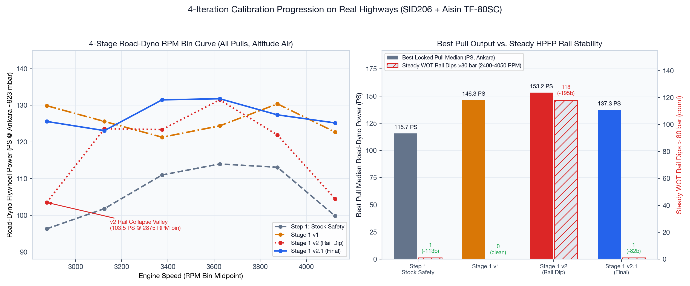
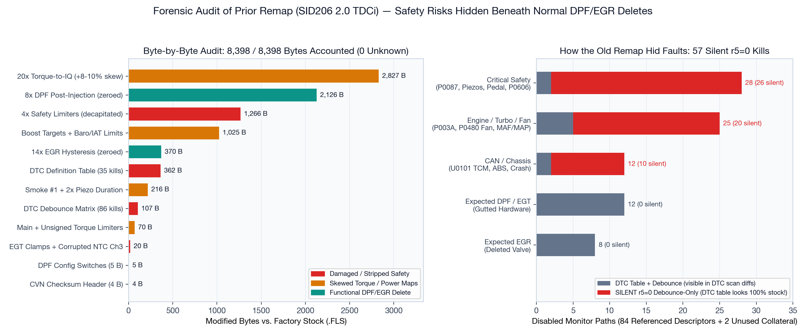

# Reverse-engineering my car's ECU and tuning it from 130 to 190 HP myself

I bought a 2011 Ford Mondeo Mk4.5 estate (`2.0 TDCi`, 130 PS factory, 6-speed Aisin `TF-80SC` automatic) with around 300,000 km on the clock. I bought it thinking the injectors were healthy and that the ECU was stock aside from a physical DPF and EGR delete. After getting the injectors tested on a bench, all four piezo injectors were worn out and had to be replaced.

Even on four new injectors, warm idle stayed rough, and a deeper UDS `$19 02` scan caught a `P0089` fuel-pressure fault while generic OBD readers showed no check-engine light and zero stored codes. To find out what was actually flashed onto the car, I bought a matching `2 MiB` stock `SID206` binary online, reversed both the PowerPC firmware and Ford's official Secondary Bootloader (SBL) to dump our car's `256 KiB` calibration over OBD on a Mac, discovered an undisclosed messy remap hidden inside it, wiped those patches, and built a clean `~190 PS` tune verified with direct SRAM road logs.

---

## Contents

- [1. Results](#1-results)
- [2. Reversing the SID206 firmware](#2-reversing-the-sid206-firmware)
  - [2.1 2 MiB MPC561/MPC562 PowerPC memory map](#21-2-mib-mpc561mpc562-powerpc-memory-map)
  - [2.2 Checksums: CRC-32/MPEG-2 CVNs and the live Cks2 monitor](#22-checksums-crc-32mpeg-2-cvns-and-the-live-cks2-monitor)
  - [2.3 Cracking $27 SecurityAccess (24-bit LFSR, reversed bytes & GF(2))](#23-cracking-27-securityaccess-24-bit-lfsr-reversed-bytes--gf2)
  - [2.4 Why $23 ReadMemoryByAddress won't dump flash (and what it exposes)](#24-why-23-readmemorybyaddress-wont-dump-flash-and-what-it-exposes)
  - [2.5 Mode 22 DIDs, $31 routines, and 4,784 calibration xrefs](#25-mode-22-dids-31-routines-and-4784-calibration-xrefs)
- [3. Reversing Ford's official Secondary Bootloader (6G91-14C273-DH.vbf)](#3-reversing-fords-official-secondary-bootloader-6g91-14c273-dhvbf)
  - [3.1 Startup, IMMR peripheral remapping, and the 10 ms watchdog](#31-startup-immr-peripheral-remapping-and-the-10-ms-watchdog)
  - [3.2 The surprise in the UDS dispatch table: native $35 RequestUpload](#32-the-surprise-in-the-uds-dispatch-table-native-35-requestupload)
  - [3.3 Static call-graph proof: why reading cannot erase or write](#33-static-call-graph-proof-why-reading-cannot-erase-or-write)
  - [3.4 Exact Boot -> SBL handoff and 35-second OBD backup sequence](#34-exact-boot---sbl-handoff-and-35-second-obd-backup-sequence)
- [4. Auditing the old tune: 8,398 changed bytes (0 unaccounted)](#4-auditing-the-old-tune-8398-changed-bytes-0-unaccounted)
  - [4.1 The two-layer r5 = 0 silent DTC lobotomy (57 hidden kills)](#41-the-two-layer-r5--0-silent-dtc-lobotomy-57-hidden-kills)
  - [4.2 Skewed Torque-to-IQ (~10% gearbox torque lie) & stripped limiters](#42-skewed-torque-to-iq-10-gearbox-torque-lie--stripped-limiters)
- [5. Road telemetry: two bugs static analysis missed](#5-road-telemetry-two-bugs-static-analysis-missed)
  - [5.1 Hitting the stock fuel pump ceiling (v2 vs v2.1)](#51-hitting-the-stock-fuel-pump-ceiling-v2-vs-v21)
  - [5.2 The automatic Drive pedal override (0x07873E)](#52-the-automatic-drive-pedal-override-0x07873e)
- [6. Using AI on a binary you can't afford to brick](#6-using-ai-on-a-binary-you-cant-afford-to-brick)
- [7. Code & technical documentation](#7-code--technical-documentation)

---

## 1. Results

All acceleration and road-dyno runs below were logged at around 850 m elevation in Ankara (~923 mbar ambient air pressure), where thinner air naturally trims peak output by a few percent compared to sea level. At sea level, the same calibration automatically scales up to roughly `190 PS` and `395–400 Nm` through the factory barometric compensation maps.

| Metric | Old Remap | Restored Stock (DPF/EGR off) | Final Tune |
| :--- | :--- | :--- | :--- |
| Peak power (Ankara ~850 m / sea level) | Unlogged (flat 390 Nm limit, skewed IQ) | ~130 PS factory baseline | **180–185 PS (~190 PS / ~395–400 Nm)** |
| 80–120 km/h (Ankara) | Not logged | 10.3 s | **7.2–7.8 s** (60–100 km/h in 5.8 s) |
| Warm idle stability | Rough (~3x worse jitter) | Smooth (5.2 RPM std dev) | Smooth (5.2 RPM std dev) |
| Hidden fault codes | **57 silently muted** (injectors, fuel, CPU) | 0 (DPF/EGR only) | 0 (DPF/EGR only) |
| Gearbox torque reporting | **~10% under-reported** | Honest 1:1 | Honest 1:1 (rescaled cleanly) |
| High-pressure fuel rail | Hidden `P0087` (non-MIL `P0089` only) | Holds target cleanly | Holds 1,600 bar (118 dips cut to 1) |



Fixing the broken calibration mechanics mattered far more than adding boost or fuel. Restoring honest injector timing and Torque-to-IQ data cut warm idle jitter roughly threefold, and dialing peak fuel back just under the high-pressure pump's mechanical ceiling added more usable wheel power than asking for extra fuel.

---

## 2. Reversing the SID206 firmware

Generic hobbyist OBD tools usually only touch the calibration block without exposing how the executable firmware handles fault suppression, runtime checksum monitors, and automatic-gearbox torque routing. Opening a 15-year-old sealed aluminum ECU on a workbench risks cracking traces off the board, so first I bought a matching `2 MiB` stock `.FLS` dump online (`8G91-12K532-AC`) to study the complete Bootloader and Application code offline, before building a Mac OBD client over a Tactrix OpenPort 2.0 J2534 cable to read and write our car's `256 KiB` calibration safely.

### 2.1 2 MiB MPC561/MPC562 PowerPC memory map

The `8G91-12K532-AC` binary runs on a **32-bit big-endian Motorola/Freescale `MPC561/MPC562` PowerPC** CPU under the `ERCOSEK V4.1.16 MPC555` RTOS (version string verbatim at `0x0AAB67`), with factory Block 4 CALID `7G91-14C275-AA` sitting at flash offset `0x183396`.

One hardware trap worth flagging up front: external serial EEPROM (`.EPR`) dumps from another SID206 carry vehicle-specific PATS immobiliser keys, VIN, and injector trims — flashing a donor EEPROM bricks cranking, so only flash (`.FLS`) blocks serve as software reference. Across the `2 MiB` (`0x200000`) flash layout, PowerPC SDA/SDA2 base pointers split memory cleanly into four physical and virtual regions:

```text
Flash Offset             CPU Virtual Addr          Size       Role & Key Anchor Pointers
--------------------------------------------------------------------------------------------------
0x000000 .. 0x03FFFF     0x00000000 .. 0x0003FFFF  256 KiB    Bootloader (1:1 map; reset 0x000100 -> 0x00009F36)
                                                              Boot0/Boot1 CVNs, SBL string 0x004290, key 0x022231

0x040000 .. 0x07FFFF     0x00840000 .. 0x0087FFFF  256 KiB    Calibration (+0x800000 delta; r2 = 0x00848534 @ 0x19CCEC)
                                                              CVN 0x040104, Cks2 0x040240..0x040544, DTCs 0x04ABC4

0x080000 .. 0x1CFFFF     0x00480000 .. 0x005CFFFF  1.3 MiB    Application (+0x400000 delta; 0x0D0000..0x0FFFFF erased)
                                                              App CVN 0x100004, Cks2 caller 0x562E0C, Block 4 @ 0x180000+

(runtime only)           0x007F8000 .. 0x007FFFFF   32 KiB    Internal MPC561 SRAM (r13 = 0x007FFFF0 @ 0x19CCE4)
                                                              Stack, live sensor vars ($23 windows), SBL landing RAM
```

### 2.2 Checksums: CRC-32/MPEG-2 CVNs and the live Cks2 monitor

Before changing a single byte, we needed exact parity with every integrity check the ECU runs at boot and while driving. Searching for constants turned up three embedded CRC tables (`0x021BEC`, `0x02FFE0`, `0x0A4954`). Disassembling callers confirmed **non-reflected CRC-32/MPEG-2** (polynomial `0x04C11DB7`, init `0xFFFFFFFF`, xorout `0x00000000`). Checking against a stock image matches all three readable header regions bit-for-bit:

- **Boot0 (`0x008004`):** `0xA5D99536` across 3 ranges — exact match.
- **Boot1 (`0x020044`, Mode `09 06` CVN #3):** `0xA3C368D3` across 3 ranges — exact match.
- **Calibration (`0x040104`, Mode `09 06` CVN #2):** `0x96C1E69C` (stock) across 4 ranges spanning `0x040240–0x07D1BF` — exact match.
- **Runtime Monitoring Checksum (`Cks2`, `0x1000D0`):** Separate from header CVN, routine `0x562E0C` continuously checksums `0x040240–0x040544` inside Calibration while the engine is running. Leaving that slice corrupted trips monitoring errors even if the header CVN validates, so `sid206 flash` enforces zero byte diffs inside `Cks2`.

### 2.3 Cracking $27 SecurityAccess (24-bit LFSR, reversed bytes & GF(2))

To unlock Boot flashing (`10 02`), Application RAM reads (`10 03` Level `0x03`), or protected routines, UDS service `$27` issues a 3-byte challenge seed and checks a 3-byte response derived from a 5-byte secret. Disassembling both `$27` handlers (`0x02E2C8` in Boot and `0x19FCA0` in Application) confirmed Ford's 24-bit Galois LFSR (`init = 0xC541A9`, feedback polynomial tap `0x909028`, stepped for 64 rounds across `[seed(3), secret(5)]`).

Reading the PowerPC instructions explained why naive ports of public Ford LFSR snippets failed until checked against disassembly: the firmware loads `secret[0]` into the top bits of `r30` and `secret[1..4]` into `r6` — the **exact byte-reversed order** relative to standard hex CLI representations:

```text
Session          Level   SendKey   Flash Offset   Notes
--------------------------------------------------------------------------------------------------
10 02 (Boot)     0x01    27 02     0x022231       Static 5-byte secret in table 0x022228 (pass raw[::-1] to CLI)
10 03 (App)      0x01    27 02     0x0A26C9       Static 5-byte secret in table 0x0A26BC (pass raw[::-1] to CLI)
10 03 (App)      0x03    27 04     0x0A26CE       Static 5-byte secret — unlocks $23 SRAM reads & $31 routines
10 03 (App)      0x11    27 12     0x0A26D3       Delay-gated / dynamic RAM-computed secret (0x0A26DB = 0x01, r13 - 0x749e)
```

Because XOR shifting over `GF(2)` is strictly linear, the 24 output bits of any response depend linearly on the 40 unknown secret bits: even without an initial flash dump, observing just *one* valid challenge-response pair on the CAN bus recovers the 5-byte secret uniquely in milliseconds (`sid206 seedkey` implements both algebraic recovery and multi-pair consistency checks).

### 2.4 Why $23 ReadMemoryByAddress won't dump flash (and what it exposes)

In an active Extended session (`10 03`), UDS service `$23 ReadMemoryByAddress` (`0x1A1F54` + parser `0x1A5BE4`, expecting `ALFID = 0x14`: `23 14 <addr_be32> <len_u8>`) validates request formatting and bounds via `0x1A565C` *before* checking security mask `0x08` (Level `0x03`). Crucially, the whitelist in `0x1A565C` permits only two 32 KiB internal SRAM windows:

- `0x007F8940 .. 0x007F8ADF`
- `0x007F8B90 .. 0x007FF7FF`

Every flash address (`0x00000000` Boot, `0x00480000` App, `0x00840000` Calibration) is unconditionally rejected with `NRC 0x31` (`requestOutOfRange`) inside Application mode. That killed the hope of using `$23` as a backup dumper — but simultaneously gave us direct memory-speed access to live desired rail pressure, fuel valve current, barometric pressure, and injected quantity (`IQ`) on the road.

### 2.5 Mode 22 DIDs, $31 routines, and 4,784 calibration xrefs

To identify live diagnostic channels and locate every calibration map automatically, we parsed three more ROM tables:

- **Mode 22 DID directory (`0x09A738–0x09B098`):** `200` entries × `12` bytes (`>IHBBBBBB`), all mapped cleanly to internal RAM variables and readable in Default session (`0x1F`) with zero seed-key unlock needed (covering ISO IDs `F1xx`, J1979 mirrors `F4xx`, and Ford extended internals `FD16–FD28` / `11xx–16xx`).
- **`$31` RoutineControl table (`0x0A2D04`, count @ `0x0A2F44`):** `24` service routines split across condition checks (`0x00563650`: `0x0202`, `0xF000`, `0xF100–0xFF00`), Level `0x03` mask `0x08` (`0x4003`, `0x8012`, `0xFD30–32`, etc.), and Level `0x11` (`0x716D`).
- **Calibration PowerPC cross-references (`0x040000–0x07D1BF`):** Scanning the Application code yielded `4,784` exact calibration references — `4,231` small-data relative (`r2 = 0x00848534`) scalars/switches/axes in `0x040544–0x04CAAC`, `189` `lis+op` 2D/3D lookup blocks in `0x04CB00–0x07AED3`, and `194` trailing refs in `0x07AED4–0x07D1BF`.
- **Why factory `P0089` stays off the dashboard:** Inspecting the `279`-entry DTC table at `0x04ABC4` (`28` bytes per entry) showed `P0089` at `0x04BC64` carries fault-class/MIL byte `0x10` (non-MIL), unlike `0x43`/`0x47` on check-engine-light codes like `P2263` or `P2002`. UDS `$19 02` still reports it; generic Mode `03` dash checks stay dark.

---

## 3. Reversing Ford's official Secondary Bootloader (6G91-14C273-DH.vbf)

With Application `$23` blocked from reading flash, reading our car's `256 KiB` calibration block cleanly over OBD normally requires uploading a custom RAM payload into MPC561 SRAM via Boot session (`10 02`) — and a subtle bug in SRAM shellcode while touching flash peripherals is a good way to turn an ECU into a paperweight. Instead, I noticed the Boot block inside our stock `2 MiB` file directly names Ford's own factory Secondary Bootloader (`6G91-14C273-DH.vbf` at `0x004290`), unpacked it (`file_checksum = 0xAD9CAEDD`), and disassembled every function in the resulting 32 KiB SRAM image.

### 3.1 Startup, IMMR peripheral remapping, and the 10 ms watchdog

Unpacking the VBF yields three discrete SRAM blocks (`21,888` B @ `0x007F8380` with CRC-16 `0x973D`, `3,828` B @ `0x007FE1D0` with CRC-16 `0xDB76`, and `1` B @ `0x007FFDA0` with CRC-16 `0xFF00`) with entry point `0x007FE254`. Disassembling initialization from `0x007FE254` proved the SBL is 100% standalone once loaded:

- Remaps internal MPC561 peripheral registers immediately via `spr 0x27e = 2` (`IMMR ISB = 0b01`), placing internal hardware registers at `0x00400000` — putting the watchdog service register `SWSR` at `0x006FC00E` and external flash control at `0x006FC800`.
- Sets an `896`-byte stack (`r1 = 0x007F8380` downward across `0x007F8000..0x007F837F`), points Small Data Area `r13 = 0x007FFFF0`, zeroes BSS (`0x007FD900..0x007FE1CF`), and builds the flash region table at `0x007FEEC8`. Notice Boot's own RAM scratch area (`0x007FFB00..0x007FFD64`) never collides with SBL code or BSS.
- Launches an 8-task cooperative scheduler (`0x007FE2AC` / `0x007FEA40`) polling a `1 ms` timer and ignition/battery monitor (`0x007FE6A8`), feeding the hardware watchdog every `10 ms` by writing `0x556C` / `0xAA39` to `0x006FC00E` (`0x007FE710`), servicing CAN/ISO-TP frames (`0x007FAA24`), and computing background CRC-16s while emitting `7F <sid> 78` responsePending frames (`0x007FAB40`).

### 3.2 The surprise in the UDS dispatch table: native $35 RequestUpload

Disassembling the 10-entry UDS service table at `0x007FBF18` (dispatched by `0x007FBC30`) delivered the turning point of the whole project: Ford's stock, unmodified VBF bootloader natively implements **UDS `$35 RequestUpload`** alongside `$34 RequestDownload` — complete with multi-region flash reading, sequence wrapping, and CRC-16 exit verification:

```text
# SBL UDS Dispatch Table (0x007FBF18)
SID   Service              Handler      Verified Firmware Behavior
----------------------------------------------------------------------------------------------------
0x10  DiagnosticSession    0x007FABF8   0x01/0x81 resets back to App; 0x02/0x82 keeps SBL active
0x11  ECUReset             0x007FACE0   0x01/0x81 hardware watchdog reset via 0x007FEDEC -> Boot+App
0x22  ReadDataById         0x007FAD60   D1 00 returns SBL heartbeat 62 D1 00 02; static IDs from Boot
0x27  SecurityAccess       0x007FAF50   27 01 -> 67 01 00 00 00; 27 02 accepts dummy bytes once in SBL
0x31  RoutineControl       0x007FB004   01 FF 00 Flash Erase (0x007FCA84); 01 FF 01 CRC-16 CheckMemory
0x34  RequestDownload      0x007FB278   34 00 44 <addr> <size>, sets download flag -0x22de(r13) = 1
0x35  RequestUpload        0x007FB440   35 00 44 <addr> <size>, sets upload flag -0x22dd(r13) = 1
0x36  TransferData         0x007FB5DC   Branches on flag; upload sends 252 B/frame, 255->0 wrap + retry
0x37  RequestTransferExit  0x007FB908   Checks remaining == 0, returns 77 <crc16_hi> <crc16_lo>
0x3E  TesterPresent        0x007FB9FC   Reloads S3 timer (0x1F4)

# Permitted External Flash Regions in SBL Descriptor Table (0x007FEEC8, 4 entries @ 0x007FEE78)
Idx   Region               CPU Start .. End              Size
----------------------------------------------------------------------------------------------------
0     Calibration          0x00840000 .. 0x0087FFFF      262,144 B (256 KiB)
1     Application 1        0x00480000 .. 0x0057FFFF    1,048,576 B (1 MiB)
2     Application 2        0x00580000 .. 0x0058FFFF       65,536 B (64 KiB)
3     Application 3        0x00590000 .. 0x005CFFFF      262,144 B (256 KiB)   (Boot excluded)
```

### 3.3 Static call-graph proof: why reading cannot erase or write

Before plugging into a live daily driver, I verified statically across Block 0 and Block 1 that a backup run cannot trigger destructive flash operations. Cross-referencing every branch target proved `flash_erase` (`0x007FCA84`) has exactly one caller (`$31 01 FF 00` at `0x007FB160`), and `flash_write` (`0x007FC920`) has exactly one caller inside the `$36` download branch (`0x007FB67C`) guarded strictly by `-0x22de(r13) == 1`. Service `$35 RequestUpload` sets upload flag `-0x22dd(r13) = 1` while leaving `-0x22de(r13)` at `0` — making flash erase and flash write statically unreachable during any backup.

### 3.4 Exact Boot -> SBL handoff and 35-second OBD backup sequence

Putting both disassemblies together gave a deterministic, recoverable transfer sequence on CAN HS (`0x7E0`/`0x7E8`, 500 kbit/s). One subtle timing detail solved why naive scripts fail right after transferring SBL: Boot's jump routine doesn't branch to `0x007FE254` immediately on receiving `31 01 03 01` — its post-TX hook (`0x02D528..0x02D558`) sends the positive response over ISO-TP first, waits for CAN transmission to complete, and *then* transfers execution to SBL:

```text
1. App -> Boot  : 10 02 (App checks engine-off precondition @ 0x005A52D4, sends 7F 10 78, jumps 0x0003FC00)
2. Unlock Boot  : 27 01 -> 27 02 <key> (computed from Boot Level 1 5-byte secret @ 0x022231)
3. Load SBL     : Stream 3 VBF SRAM segments via 34 00 44 -> 36 <seq> -> 37 (Boot verifies 0x973D / 0xDB76 / 0xFF00)
4. Execute SBL  : 31 01 03 01 00 7F E2 54 (post-TX hook 0x02D528..0x02D558 enters 0x007FE254 after ACK)
5. Confirm SBL  : 22 D1 00 -> 62 D1 00 02
6. Read ($35)   : 35 00 44 00 84 00 00 00 04 00 00 -> loop 1,041 x 36 <seq> (252 B chunks, ~35 s for 256 KiB)
                  -> 37 verifies SBL CRC-16 against local crc16_ccitt; optional App 1-3 follow same path
7. Write ($34)  : Offline Cks2/CVN/boot-tail checks -> 31 01 FF 00 erase -> 34 00 44 -> 252 B 36 chunks
                  -> verify BOTH 37 and 31 01 FF 01 CRC-16s -> 11 01 watchdog reset -> Mode 09 06 CVN verify
```

---

## 4. Auditing the old tune: 8,398 changed bytes (0 unaccounted)

Once we dumped our car's `256 KiB` calibration block over OBD (~35 seconds via the SBL) and diffed it against offsets `0x040000–0x07FFFF` of the stock `8G91-12K532-AC` `.FLS` image, it turned out the car wasn't stock aside from DPF/EGR delete at all — someone had flashed an undisclosed remap onto it. Using `sid206 audit` and the `4,784` disassembled PowerPC cross-references, all **8,398 changed bytes** were classified with zero bytes left unexplained:



### 4.1 The two-layer r5 = 0 silent DTC lobotomy (57 hidden kills)

Disassembly of fault evaluator `0x50A9AC` revealed why naive DTC-table comparisons miss half of what automated DTC-remover tools break. SID206 validates every fault in two distinct stages:

- **Layer 1 — Debounce matrix (`0x048E84–0x049086`):** Supplies step increment `r5` and trip limit `r6` to handler `0x50A9AC`. Setting `r5 = 0` makes `0x50AA70` / `0x50AAEC` immediately clear `fault_active = 0` and exit early.
- **Layer 2 — DTC definition table (`0x04ABC4–0x04CA48`):** Holds the `279` OBD/Ford P-codes and MIL/class byte — never reached when Layer 1 zeroes `r5`.

Out of `86` crippled monitor paths (`84` Application-referenced plus `2` collateral slots), only `29` were cleared in Layer 2. The other **57 fault monitors appeared 100% stock** in standard DTC table editors while silently dead — including low fuel rail pressure (`P0087`, silenced at `0x048EE2` — explaining why collapsing fuel pressure surfaced only as non-MIL `P0089`), FRP sensor faults (`P0190/91/94`), all four piezo injectors (`P0201–04`, `P1201–04`, `P1551–54`), accelerator pedal sensors (`P2120–38`), cooling fan control (`P0480`), A/C pressure (`P1461–63`, collateral damage from a `P14xx` regex pass), `12` ABS/gearbox/crash CAN codes, and even CPU self-test `P0606`.

### 4.2 Skewed Torque-to-IQ (~10% gearbox torque lie) & stripped limiters

- **Torque-to-IQ skew (`2,827` bytes across 20 maps):** Instead of calibrating the real torque chain properly, the prior tune inflated injected quantity assumptions by `+8–10%` above `200 Nm`. The engine delivered fuel while under-reporting actual torque by roughly `10%` over CAN to the 6-speed Aisin automatic gearbox and upsetting closed-loop warm idle control.
- **Decapitated safety protections (`1,266` bytes) + NTC typo:** Coolant overheat derate (`0x0790E2`, caller `0x5C70F8`) was zeroed; oil/coolant temperature (`0x07932A`) and barometric altitude protection (`0x07909A`) were flattened to `450 Nm`; limp-home cut (`0x07B244`) was flattened to `300 Nm` everywhere; IAT/Baro boost limiters were multiplied flat `+15.1%` even at `100 °C`; and a stray byte edit broke an `NTC Ch3` sensor curve (`0x048476`) from `115 °C` to `205 °C`.

Before tuning anything for power, I deleted all of it: restored pure stock calibration tables, retained *only* the emissions switches (`5` switches, `8` post-injection maps, `14` EGR hysteresis curves) matching the gutted hardware actually on the car, and confirmed warm idle immediately settled down to a clean `5.2 RPM` standard deviation with every safety monitor restored. (Full table in [docs/tune-audit-case-study.md](../docs/tune-audit-case-study.md).)

---

## 5. Road telemetry: two bugs static analysis missed

Standard OBD PID polling (~5–10 Hz) drops too many samples to catch fast fuel-rail dips or automatic torque-converter lockup slip during full-throttle shifts. Using the whitelisted `$23` SRAM windows from Section 2.4 alongside synchronous `TF-80SC` transmission polling (`sid206 log-tcm` at ~4.9 Hz and `sid206 log-rail` at ~10–11 Hz), road pulls immediately uncovered two physical and code realities static table inspection never showed.

### 5.1 Hitting the stock fuel pump ceiling (v2 vs v2.1)


In my early full-power calibration (`v2`), asking the 300,000 km high-pressure pump for `75–79 mg/stroke` at `1,600 bar` outran its volumetric flow limit in the midrange: rail pressure dropped more than `80 bar` below target `118` times across steady WOT pulls, sinking as low as `-195 bar` around `2,900 RPM` and carving a noticeable midrange torque hole.

Pulling peak demand back to `70.5–72 mg/stroke` (`v2.1`) stayed just under what the pump holds cleanly at `1,600 bar`. Pressure dips over `80 bar` plummeted from `118` to `1` (zero dips over `100 bar`), and measured power in the `2,875 RPM` bin jumped straight from `103.5 PS` back up to `125.6 PS` (climbing to `131.5 PS` at `3,375 RPM`).

### 5.2 The automatic Drive pedal override (0x07873E)


On one highway test drive while experimenting with intermediate calibrations, editing all six standard Driver's Wish pedal maps (`0x051AE0–0x0524E0`) made no difference at part throttle and that test revision felt unexpectedly flat. Going back to the PowerPC disassembly explained why: caller `0x5CF024` checks transmission mode and, when an automatic car is in Drive, ignores those six pedal maps completely in favor of a separate `16×16` Pedal-vs-Speed table at `0x07873E` — which also applies a `25–32%` top-end factory taper above `180 km/h`.

Reshaping `0x07873E` restored crisp highway response (lifting `38–55%` pedal fueling around `2,000 RPM` from `33–42 mg/stroke` to `40–57 mg/stroke`) with 100% honest gearbox torque math. In Ankara, `80–120 km/h` fell from `10.3 s` stock to `7.2–7.8 s` (`60–100 km/h` in `5.8 s`, turbo spool in `~1.1 s`), and driving down to Istanbul verified the factory altitude tables automatically scaled output toward `~190 PS` at sea level.

---

## 6. Using AI on a binary you can't afford to brick

Most of this workflow worked because AI handled high-volume reverse-engineering drudgery while deterministic code and hardware checks acted as hard gates. Lifting raw `2 MiB` PowerPC disassembly into readable C control flow, mapping `8,398` diff bytes across `4,784` firmware references, and spotting indirect pointer `0x5CF024 -> 0x07873E` would have taken weeks alone.

Conversely, you never let an LLM guess a byte offset, endianness rule, or checksum before flashing your own car. Every claimed table or branch had to trace back to verified MPC561 assembly, our flasher enforces offline `CRC-32/MPEG-2` and `Cks2` invariants before opening CAN, and live SRAM logs caught mechanical realities — like those `118` fuel-pump dips — that static disassembly could never predict.

---

## 7. Code & technical documentation

All reverse-engineering scanners, official-SBL backup/write tools, `$23` SRAM + `TF-80SC` loggers, road-dyno analytics, and offline unit/hygiene tests live in [README.md](../README.md) and `src/sid206/`. OEM binaries, personal drive logs, VINs, ECU serials, and extracted 5-byte secrets are intentionally omitted.

- [README.md](../README.md) — installation, arming guards, and CLI examples (`sid206 obd|re|audit|backup|flash|log-tcm|dyno`)
- [docs/sid206-firmware-re.md](../docs/sid206-firmware-re.md) — complete `MPC561` memory map, CVNs, `$27/$23/$31` tables & DTC layout
- [docs/sbl-6g91-14c273-dh-re.md](../docs/sbl-6g91-14c273-dh-re.md) — `6G91-14C273-DH.vbf` SBL disassembly, scheduler, dispatch table & call-graph proof
- [docs/tune-audit-case-study.md](../docs/tune-audit-case-study.md) — full `8,398`-byte breakdown & TunerPro map offset table
